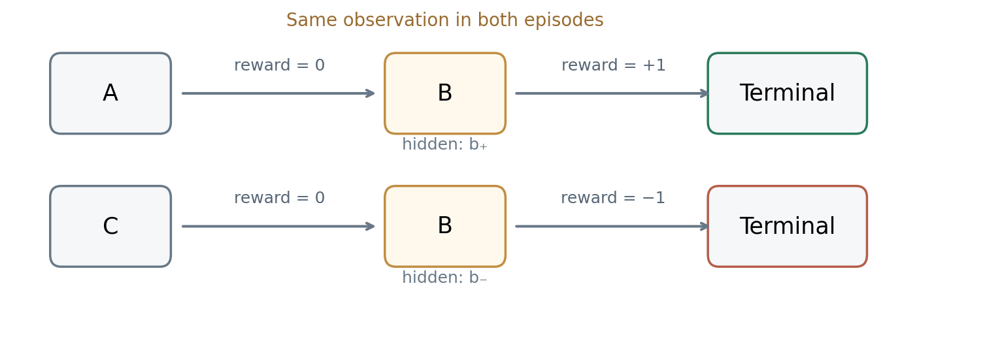

# Vikram's Data Science Blog

```{raw} html
<div class="landing-hero">
  <p class="landing-tagline">&ldquo;The real voyage of discovery consists not in seeking new landscapes,
  but in having new eyes.&rdquo;</p>
  <p class="landing-actions">
    <a class="landing-button landing-button-ghost" href="about.html">About</a>
  </p>
</div>

<a class="post-card post-card-featured" href="typical-sets-and-data-compression.html">
  
  <span class="featured-text">
    <span class="post-tag">Latest &middot; Information theory</span>
    <span class="post-title">How the Law of Large Numbers Makes Data Compression Possible</span>
    <span class="post-teaser">Almost every long sequence of coin tosses looks the same: it lands in the
    &ldquo;typical set.&rdquo; That concentration is the engine behind lossless data compression &mdash;
    and the reason entropy is measured in bits.</span>
  </span>
</a>

<h2 class="landing-section">Recent posts</h2>
<div class="post-grid">
  <a class="post-card" href="monte-carlo-vs-td-partial-observability.html">
    
    <span class="post-tag">Reinforcement learning</span>
    <span class="post-title">Why Monte Carlo Beats TD Learning in Some Partially Observable Environments</span>
  </a>
  <a class="post-card" href="law-of-large-numbers-clt.html">
    
    <span class="post-tag">Statistics</span>
    <span class="post-title">The Law of Large Numbers and the Central Limit Theorem</span>
  </a>
  <a class="post-card" href="how-gradient-variance-shapes-policy-optimization-rewritten.html">
    
    <span class="post-tag">Reinforcement learning</span>
    <span class="post-title">How Gradient Variance Shapes Policy Optimization</span>
  </a>
  <a class="post-card" href="curse-of-dimensionality.html">
    
    <span class="post-tag">Theory</span>
    <span class="post-title">The Curse of Dimensionality: Why It Matters Less Than You Think</span>
  </a>
  <a class="post-card" href="pallas-flash-attn.html">
    
    <span class="post-tag">JAX &amp; GPU kernels</span>
    <span class="post-title">How to Write a Flash Attention Kernel in Pallas</span>
  </a>
</div>
<p class="landing-archive-note">Browse the full archive by year in the sidebar.</p>
```
